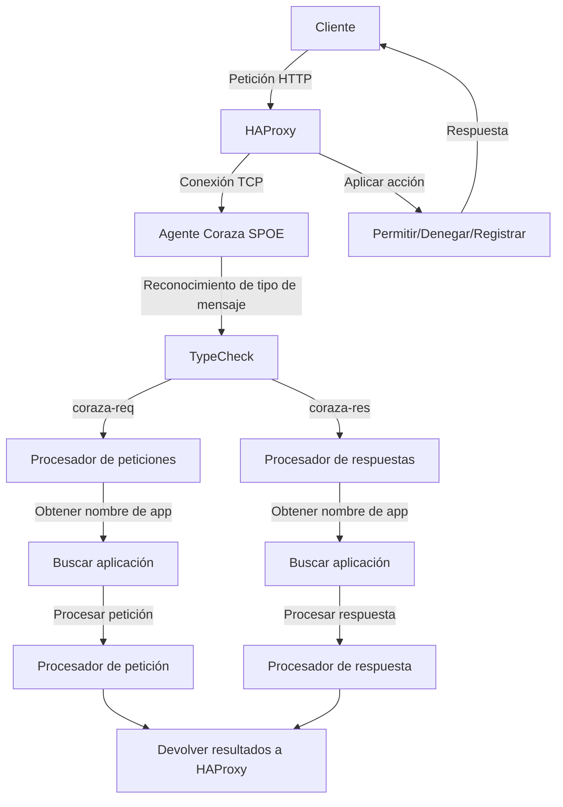

# EscudoWAF

<div align="center">
  
  
  
  
</div>

<br>

**EscudoWAF** es un sistema de gestión de firewall de aplicaciones web (WAF) construido sobre [HAProxy](https://www.haproxy.org/) y [OWASP Coraza WAF](https://github.com/corazawaf/coraza), con la integración [Coraza SPOA](https://github.com/corazawaf/coraza-spoa). Proporciona una API backend completa y un panel web para gestionar la configuración de HAProxy, las reglas del WAF y la inspección de tráfico.

EscudoWAF es un fork traducido al español de [RuiQi](https://github.com/HUAHUAI23/RuiQi) (MIT), de HUAHUAI23. Todo el crédito de la arquitectura y la implementación original corresponde a su autor.

## 📸 Interfaz

<div align="center">
  <table cellspacing="0" cellpadding="10" style="border-collapse: separate; border-spacing: 15px; background-color: #f8f9fa;">
    <tr>
      <td align="center" style="border-radius: 8px; border: 1px solid #ddd; padding: 12px; box-shadow: 0 4px 8px rgba(0,0,0,0.1);">
        
      </td>
      <td align="center" style="border-radius: 8px; border: 1px solid #ddd; padding: 12px; box-shadow: 0 4px 8px rgba(0,0,0,0.1);">
        
      </td>
    </tr>
    <tr>
      <td align="center" style="border-radius: 8px; border: 1px solid #ddd; padding: 12px; box-shadow: 0 4px 8px rgba(0,0,0,0.1);">
        
      </td>
      <td align="center" style="border-radius: 8px; border: 1px solid #ddd; padding: 12px; box-shadow: 0 4px 8px rgba(0,0,0,0.1);">
        
      </td>
    </tr>
  </table>
</div>

## Arquitectura

EscudoWAF implementa una arquitectura modular con HAProxy al frente gestionando el tráfico y varios motores de seguridad proporcionando protección:

1. **Motor Coraza WAF**: filtrado compatible con OWASP ModSecurity
2. **MicroEngine**: motor de coincidencia basado en reglas para filtrado de IP, comprobación de URL y lógica condicional compleja
3. **Análisis geográfico**: filtrado de tráfico basado en ubicación
4. **Limitación de velocidad**: control de tráfico y restricción de peticiones



## Funcionalidades

- **Protección multi-motor**

  - **Motor Coraza WAF**:
    - Soporte del OWASP Core Rule Set (CRS)
    - Compatibilidad con reglas SecLang de ModSecurity
    - Gestión de reglas personalizadas

  - **MicroEngine**:
    - Coincidencia basada en reglas para IP, URL y ruta de petición
    - Combinaciones de condiciones complejas (lógica AND/OR)
    - Listas blancas/negras de IP con soporte CIDR
    - Coincidencia eficiente por regex con caché

  - **Análisis geográfico**:
    - Filtrado por país y región
    - Visualización geográfica de ataques

  - **Control de tráfico**:
    - Limitación de velocidad y restricción de peticiones
    - Mecanismos de control de conexión

- **Integración con HAProxy**

  - Gestión completa del ciclo de vida de HAProxy (iniciar, detener, reiniciar)
  - Generación dinámica de configuración
  - Monitorización de estado en tiempo real

- **Seguridad avanzada**

  - Inspección de peticiones HTTP
  - Inspección de respuestas HTTP
  - Detección y prevención de ataques en tiempo real
  - Sistema de permisos de usuario RBAC

- **Monitorización y registros**

  - Registros y analítica de ataques del WAF
  - Estadísticas de tráfico
  - Métricas de rendimiento

- **Flujo de trabajo basado en API**
  - API RESTful con el framework Gin
  - Documentación de API con Swagger/ReDoc
  - Autenticación JWT

## Requisitos previos

- Docker y Docker Compose (para despliegue)
- Go 1.24+ y Node.js con pnpm (para desarrollo local)

## Despliegue con Docker

1. Clonar el repositorio:

```bash
git clone https://github.com/anticoi/EscudoWAF.git
cd EscudoWAF
```

2. Desplegar con Docker Compose (incluye MongoDB):

```bash
# Editar docker-compose.yaml para ajustar las variables de entorno si es necesario
docker-compose up -d
```

3. Alternativamente, compilar la imagen Docker manualmente:

```bash
docker build -t escudo-waf:latest .
docker run -p 2333:2333 -p 8080:8080 -p 443:443 -p 80:80 -p 9443:9443 -p 8404:8404 escudo-waf:latest
```

Usuario por defecto: **admin** · Contraseña por defecto: **admin123**

## Desarrollo local

1. Clonar el repositorio:

```bash
git clone https://github.com/anticoi/EscudoWAF.git
cd EscudoWAF
```

2. Preparar el entorno de desarrollo del frontend:

```bash
cd web
pnpm install
pnpm dev    # modo desarrollo con recarga en caliente
# o
pnpm build  # compilación de producción
cd ..
```

3. Configurar el entorno del backend:

```bash
cp server/.env.template server/.env
# Editar .env con tu configuración
```

4. Ejecutar el servicio backend en Go:

```bash
go work use ./coraza-spoa ./pkg ./server
cd server
go run main.go
```

El servidor de desarrollo se iniciará con:

- API: `http://localhost:2333/api/v1`
- Swagger UI: `http://localhost:2333/swagger/index.html`
- ReDoc: `http://localhost:2333/redoc`
- Frontend: `http://localhost:2333/`

## Licencia

Este proyecto está licenciado bajo la licencia MIT — ver el archivo [LICENSE](./LICENSE) para más detalles.

## Agradecimientos

- [RuiQi](https://github.com/HUAHUAI23/RuiQi) — proyecto original del que deriva este fork (MIT, © HUAHUAI23)
- [OWASP Coraza WAF](https://github.com/corazawaf/coraza)
- [Coraza SPOA](https://github.com/corazawaf/coraza-spoa)
- [HAProxy](https://www.haproxy.org/)
- [Go Gin Framework](https://github.com/gin-gonic/gin)
